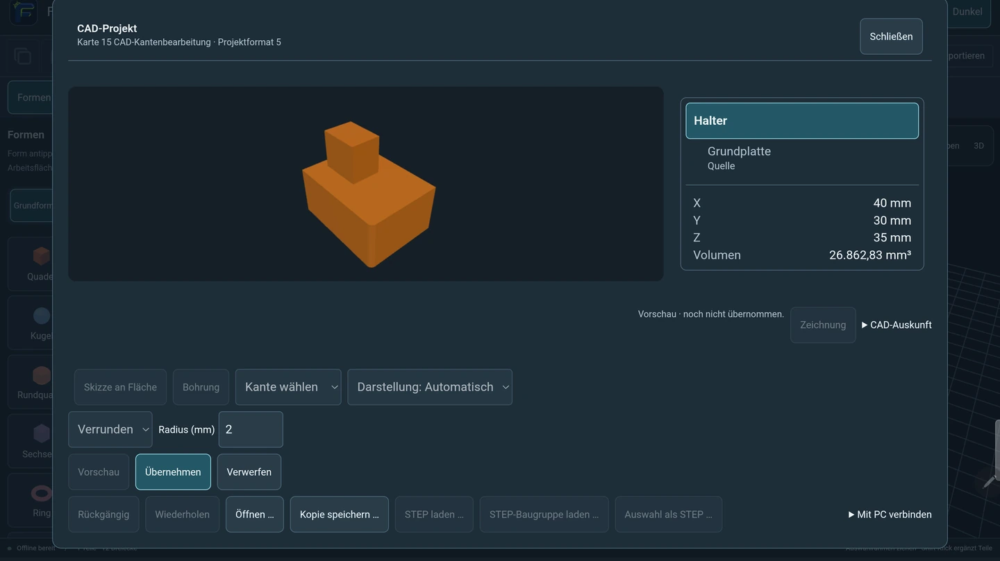
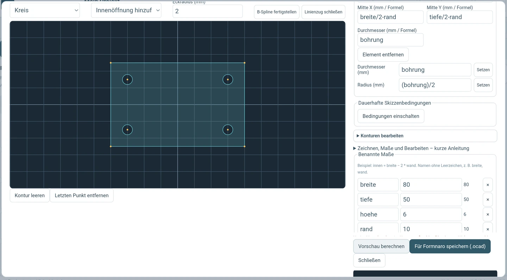
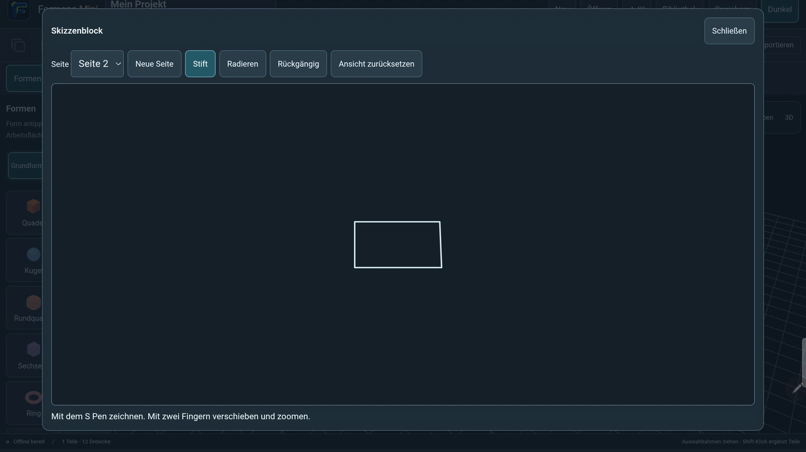
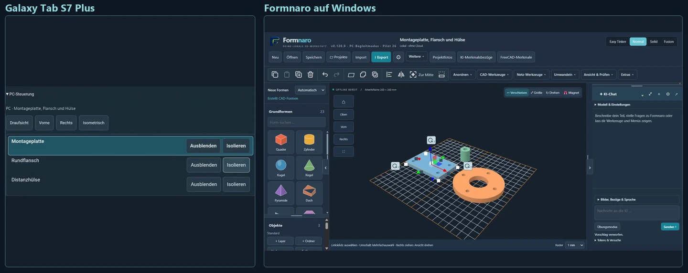

  

<h1 align="center">Formano Mini für Android</h1>

Mit dem S Pen skizzieren, Bauteile in 3D konstruieren und mit Formnaro auf dem PC weiterarbeiten.

  <strong><a href="https://github.com/andyy909/Formnaro-Android/releases/download/v0.1.0-pilot.32/Formano-Mini-Pilot-32.apk">Pilot-32-APK herunterladen</a></strong>
  · <a href="https://github.com/andyy909/Formnaro-Android/releases/tag/v0.1.0-pilot.32">Versionshinweise</a>
  · <a href="README.md">English</a>

*Vorschau einer Verrundung am Beispielhalter, aufgenommen auf einem Galaxy Tab S7 Plus.*

**Öffentliche Testversion · Pilot 32 · Android 10 oder neuer**

Formano Mini wird aktiv weiterentwickelt. CAD-Editor und Skizzenblock laufen offline auf dem Tablet. Für die PC-Funktionen brauchst du einen [passenden Windows-Begleitbuild](#geprüfte-kompatibilität) im selben lokalen Netzwerk.

## Was heute schon geht

| Einsatz | In Pilot 32 |
| --- | --- |
| **Präzise 2D-Profile zeichnen** | Skizzen bemaßen, geometrische Beziehungen setzen und geschlossene Profile in 3D-Körper überführen. |
| **3D-Teile bearbeiten** | Parametrische Körper, Bohrungen, Verrundungen und Fasen erstellen. Änderungen in der Vorschau prüfen, übernehmen, rückgängig machen und wiederholen. |
| **CAD-Dateien bearbeiten** | `.ocad`-Projekte öffnen und speichern, STEP importieren und exportieren sowie unterstützte FNPACK-Projekte öffnen. |
| **Einen Werkstatt-Skizzenblock führen** | Mit dem S Pen freihändig zeichnen, Striche radieren und mehrere Seiten direkt auf dem Tablet behalten. |
| **Mit einem gekoppelten PC arbeiten** | Projektkopien senden, der Teileauswahl am PC folgen, Ansichten wechseln, Teile einblenden oder isolieren und CAD-Maße ablesen. PC-Ansichten im Skizzenblock festhalten und beschriftete Seiten als Projektnotizen zurückschicken. |

| Bemaßte CAD-Skizze | Freihand-Skizzenblock |
| :---: | :---: |
|  |  |

*Aufnahmen aus den Gerätetests. CAD-Skizze und Freihand-Skizzenblock sind zwei eigene Werkzeuge.*

## Installieren und ausprobieren

1. Lade die [Pilot-32-APK](https://github.com/andyy909/Formnaro-Android/releases/download/v0.1.0-pilot.32/Formano-Mini-Pilot-32.apk) herunter und öffne sie auf deinem Android-Tablet. Falls Android nachfragt, erlaube der App, aus der du die Datei öffnest, die Installation.
2. Öffne **Skizzenblock** für Freihandzeichnungen oder **CAD-Projekt**, um ein 3D-Projekt anzulegen oder zu öffnen. Beides geht ohne PC.
3. Lege bei wichtigen Projekten eine separate Kopie an, wenn du mit der Vorabversion arbeitest.

Die APK ist mit dem Pilotzertifikat signiert. Die [SHA-256-Datei](https://github.com/andyy909/Formnaro-Android/releases/download/v0.1.0-pilot.32/Formano-Mini-Pilot-32.apk.sha256) enthält die Prüfsumme zum Download.

## Mit Formnaro auf dem PC verbinden

*Live-Auswahl im PC-Begleitmodus. Links die Teileliste am Tablet, rechts das offene Modell am PC.*

1. Verbinde Tablet und PC mit demselben lokalen Netzwerk.
2. Öffne im Windows-Begleitbuild **Projekte → Tablet verbinden** und erstelle eine Einladung.
3. Öffne am Tablet **CAD-Projekt → Mit PC verbinden**. Scanne den QR-Code oder gib den Kopplungscode manuell ein. Bestätige die Verbindung am PC.
4. Gib am PC die Live-Steuerung frei, wenn du die PC-Ansicht am Tablet bedienen möchtest. Gesendete Skizzenblockseiten findest du im gespeicherten Windows-Projekt unter **Projekte → Tablet-Notizen**.

### Geprüfte Kompatibilität

| Komponente | Geprüfter Stand |
| --- | --- |
| Android-Build | `0.1.0-pilot.32`, Build 36 |
| Physisches Testgerät | Samsung Galaxy Tab S7 Plus (SM-T970), Android 13 |
| Windows-Kopplung | Privater Formnaro PC-Begleitmodus Pilot 32, Commit `64cf5fd409231014090b2b57c3c556ccaf2f299f` |

Die öffentliche APK lässt sich eigenständig nutzen. Der geprüfte Windows-Begleitbuild ist privat. Für die regulären Windows-Downloads im [Formnaro-Desktop-Repository](https://github.com/andyy909/Formnaro-cad) ist die Kopplung mit dieser APK bisher unbestätigt.

## Was als Nächstes geplant ist

*Entwicklungsstand vom 22. November 2026.*

| Bereich | Stand |
| --- | --- |
| **Skizzen und Teile an den PC übergeben** | Interne Piloten haben eine bemaßte Tablet-Skizze auf eine ausgewählte PC-Fläche gesetzt und ein editierbares Bauteil samt Quellgeometrie und Parametern übertragen. Der Teiletransfer wurde in Pilot 35 im WLAN geprüft. |
| **Mit dem S Pen konstruieren** | Geradenerkennung durch kurzes Halten mit echtem S Pen prüfen. Danach Kreise und wählbare Skizzenbeziehungen ergänzen. |
| **Werkstücke vom Foto nachzeichnen** | Ein Foto mit einem bekannten Maß kalibrieren, darauf ein Profil zeichnen und es auf einer gewählten Modellfläche am PC weiterbearbeiten. |
| **Notizen am Modell verankern** | Eine Werkstattnotiz einer Stelle am Modell zuordnen und aus der Projektnotiz dorthin zurückspringen. |
| **Ein öffentliches Android- und Windows-Paar** | Den gesamten Ablauf mit einer fest benannten APK und Windows-Version prüfen und beide anschließend gemeinsam bereitstellen. |

## Rückmeldungen und Entwicklung

Bei einem Fehlerbericht helfen Pilotnummer, Gerät, Android-Version und die Schritte zum Nachstellen. Bei Kopplungsproblemen bitte auch den Windows-Build angeben. Kopplungscodes und persönliche Projektdateien gehören nicht in öffentliche Berichte. [Fehler melden](https://github.com/andyy909/Formnaro-Android/issues/new)

Dieses Repository enthält Android-Pilotdownloads und Dokumentation. Android und Windows teilen sich die CAD-Kernanbindung, den Skizzeneditor und den Code für Projektdateien im Formnaro-Entwicklungsprojekt. [Formnaro für Windows](https://github.com/andyy909/Formnaro-cad) · [Projektwebsite](https://formnaro.de/)

Das App-Symbol verwendet eine Bearbeitung des von Google erstellten und veröffentlichten Android-Roboters unter <a href="https://creativecommons.org/licenses/by/3.0/">CC BY 3.0</a>. <a href="https://developer.android.com/distribute/marketing-tools/brand-guidelines#android-robot">Bildnachweis</a>.
