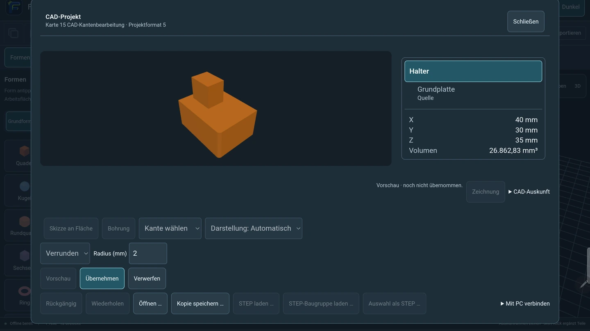
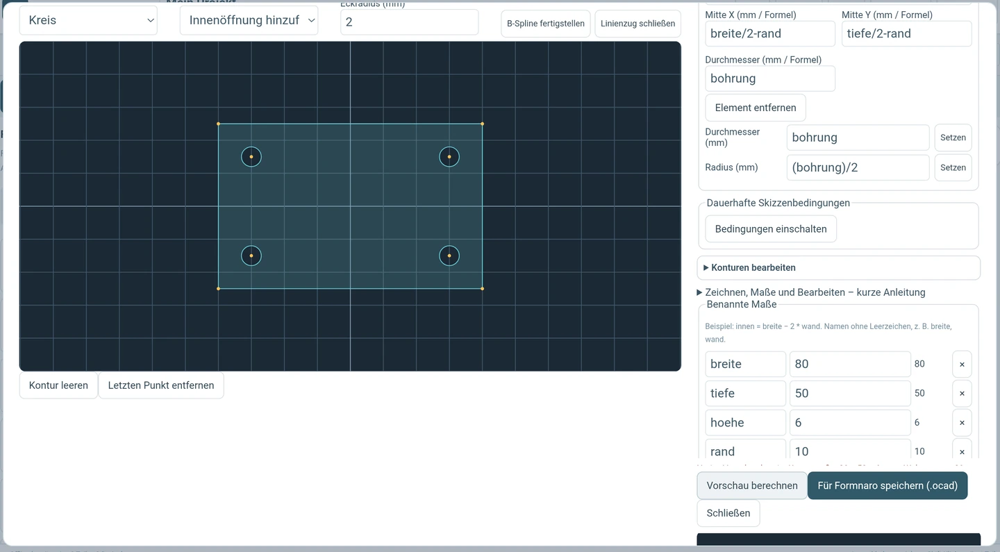
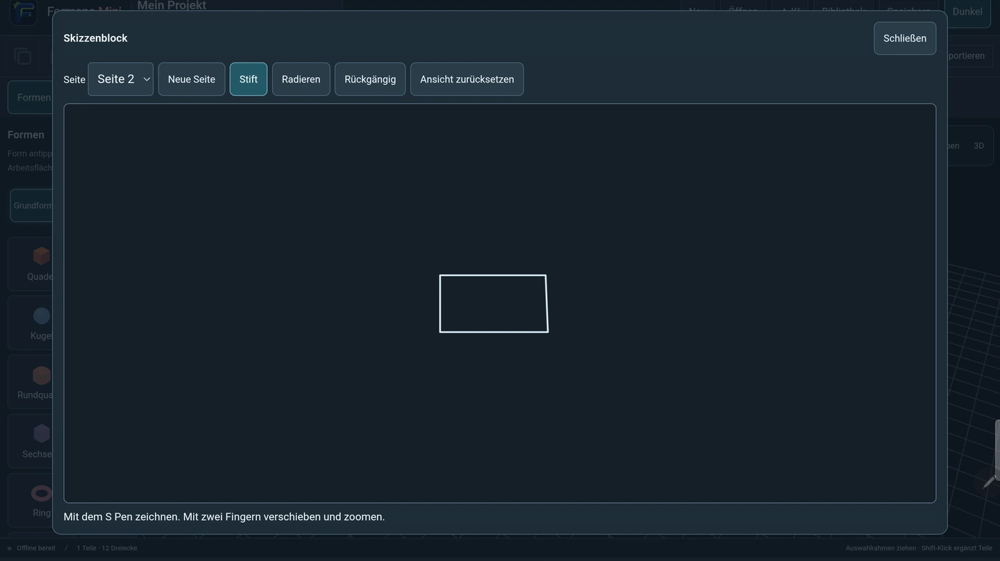
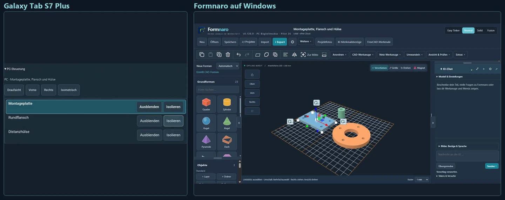

  

<h1 align="center">Formano Mini for Android</h1>

Sketch with the S Pen, build parts in 3D and work with Formnaro on Windows.

  <strong><a href="https://github.com/andyy909/Formnaro-Android/releases/download/v0.1.0-pilot.32/Formano-Mini-Pilot-32.apk">Download Pilot 32 APK</a></strong>
  · <a href="https://github.com/andyy909/Formnaro-Android/releases/tag/v0.1.0-pilot.32">Release notes</a>
  · <a href="README.de.md">Deutsch</a>

*Fillet preview on a test bracket, captured on a Galaxy Tab S7 Plus.*

**Public preview · Pilot 32 · Android 10+**

Formano Mini is in active development. The CAD editor and sketchbook run offline on the tablet. Live PC features require a [compatible Windows companion build](#verified-compatibility) on the same local network.

## What you can do today

| On the tablet | In Pilot 32 |
| --- | --- |
| **Draw precise 2D profiles** | Make dimensioned sketches with constraints and turn closed profiles into 3D features. |
| **Edit 3D parts** | Create parametric bodies, add holes, fillets or chamfers, and preview changes before applying them. Undo and redo are available in the CAD workspace. |
| **Work with CAD files** | Open and save `.ocad` projects, import and export STEP and open supported FNPACK projects. |
| **Keep a workshop sketchbook** | Draw freehand with the S Pen, erase strokes and keep multiple pages on the tablet. |
| **Work with a paired PC** | Send project copies, follow the PC’s part selection, switch views, show or isolate parts and take CAD measurements. Save a PC view in the sketchbook and send annotated pages back as project notes. |

| Dimensioned CAD sketch | Freehand sketchbook |
| :---: | :---: |
|  |  |

*Screenshots from device testing. The CAD sketch and the freehand sketchbook are separate tools.*

## Install and try it

1. Download the [Pilot 32 APK](https://github.com/andyy909/Formnaro-Android/releases/download/v0.1.0-pilot.32/Formano-Mini-Pilot-32.apk) and open it on your Android tablet. If Android prompts you, allow app installation for the app you opened the file from.
2. Open **Skizzenblock** to draw freehand, or **CAD-Projekt** to create or open a 3D project. Both work without a PC.
3. Keep a separate copy of important projects when working with a preview build.

The APK uses the pilot signing certificate. You can verify the download against the [SHA-256 file](https://github.com/andyy909/Formnaro-Android/releases/download/v0.1.0-pilot.32/Formano-Mini-Pilot-32.apk.sha256).

## Connect to Formnaro on Windows

*Live selection in the PC companion demo. The tablet is on the left and Windows is on the right.*

1. Connect the tablet and PC to the same local network.
2. In the Windows companion build, open **Projekte → Tablet verbinden** and create an invitation.
3. On the tablet, open **CAD-Projekt → Mit PC verbinden**. Scan the QR code or enter the manual pairing code, then confirm the connection on Windows.
4. Enable live controls on Windows if you want to control the PC view from the tablet. Transferred sketchbook pages can be opened in a saved Windows project under **Projekte → Tablet-Notizen**.

### Verified compatibility

| Component | Tested configuration |
| --- | --- |
| Android build | `0.1.0-pilot.32`, build 36 |
| Physical device | Samsung Galaxy Tab S7 Plus (SM-T970), Android 13 |
| Windows pairing | Private Formnaro PC Companion Pilot 32, commit `64cf5fd409231014090b2b57c3c556ccaf2f299f` |

The public APK can be used on its own. The Windows build used for pairing is private. The regular Windows downloads in the [Formnaro desktop repository](https://github.com/andyy909/Formnaro-cad) have no confirmed pairing compatibility with this APK.

## Roadmap

*Development status as of 22 November 2026.*

| Area | Status |
| --- | --- |
| **Tablet-to-PC sketch and part transfer** | Internal pilots have placed a dimensioned tablet sketch on a selected PC face and transferred an editable part with its source geometry and parameters. The part transfer was verified over Wi-Fi in Pilot 35. |
| **Drawing with the S Pen** | Test press-and-hold line recognition with a physical S Pen, then extend the workflow to circles and optional sketch constraints. |
| **Tracing real parts from photos** | Calibrate a photo using a known dimension, trace a profile on the tablet and continue editing it on a chosen Windows model face. |
| **Notes tied to the model** | Attach a workshop note to a model location and jump back to it from the project notes. |
| **A public Android and Windows pair** | Run the full workflow with a specific APK and Windows build, then publish a matched pair after testing. |

## Feedback and development

For a bug report, include your pilot number, device, Android version and steps to reproduce the issue. For pairing problems, include the Windows build too. Leave pairing codes and personal project files out of the report. [Report an issue](https://github.com/andyy909/Formnaro-Android/issues/new)

This repository hosts Android pilot downloads and documentation. Android and Windows share the CAD kernel integration, sketch editor and project-file code in the Formnaro development project. [Formnaro for Windows](https://github.com/andyy909/Formnaro-cad) · [Project website](https://formnaro.de/en/)

The app icon adapts the Android robot artwork created and shared by Google under <a href="https://creativecommons.org/licenses/by/3.0/">CC BY 3.0</a>. <a href="https://developer.android.com/distribute/marketing-tools/brand-guidelines#android-robot">Artwork attribution</a>.
